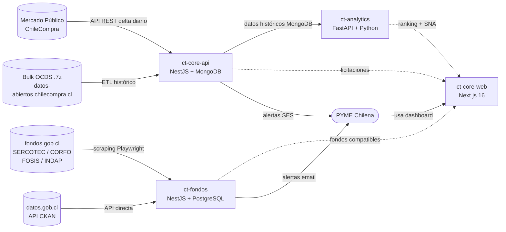
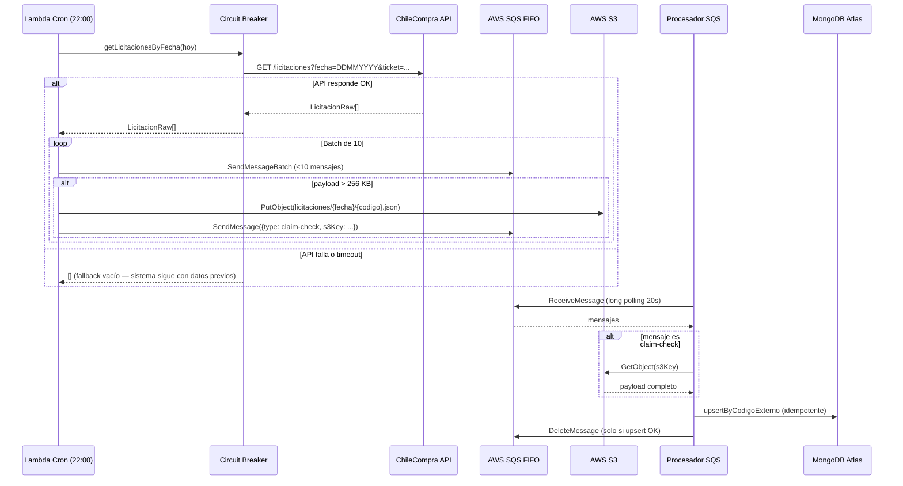
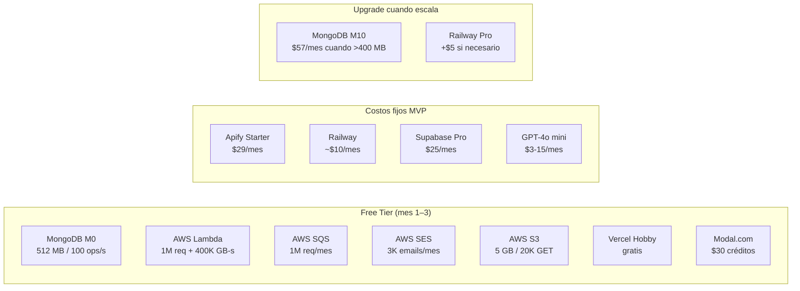

# Diagramas de Componentes — ParaPymes CompraTransparente

Propósito: mapa estructural estable del ecosistema. Actualizar solo si cambia la topología (agregar/quitar servicios, cambiar fronteras).

---

## Contexto (alto nivel)



---

## Componentes principales

```mermaid
flowchart TB
    subgraph PYME_ACTOR["Actor"]
        P([PYME Chilena])
    end

    subgraph FRONTEND["ct-core-web — Vercel"]
        DASH[Dashboard\nNext.js 16 App Router]
        AUTH[Auth\nSupabase SSR]
        MW[Middleware Edge\nCSP + Rate Limit + RBAC]
        PR1[@liveTenderFeed\nParallel Route]
        PR2[@analyticsGraph\nParallel Route]
        PR3[@accountingSummary\nParallel Route]
        IR[(Intercepting Route\nModal Detalle)]
        SA[Server Actions\nFavoritos + Alertas]
    end

    subgraph CORE_API["ct-core-api — AWS Lambda + MongoDB Atlas"]
        INGESTA[Servicio Ingesta\nCron 22:00 + Circuit Breaker]
        SQS_PUB[SQS Publisher\nBatch ≤10 / Claim-Check S3]
        SQS_CON[Procesador SQS\nCQRS + Idempotencia]
        DLQ[DLQ Handler\nAlertas SES]
        LIC_REPO[(LicitacionesRepository\nupsertByCodigoExterno)]
        MONGO[(MongoDB Atlas\nM0→M10)]
    end

    subgraph FONDOS_SVC["ct-fondos — Railway"]
        SCRAPER[Scrapers\nPlaywright + Crawlee]
        APIFY[(Apify Starter\n$29/mes hosting)]
        MATCH[Motor Matching\nPrisma SQL]
        ALERTA_SVC[Alertas\nResend Email]
        COPILOTO[Copiloto LLM\nLlamaIndex + GPT-4o mini]
        PG[(PostgreSQL Railway\nFondo + PymeProfile + Alerta)]
    end

    subgraph ANALYTICS_SVC["ct-analytics — Modal + Railway"]
        ETL[ETL Bulk OCDS\n+ Compra Ágil CSV]
        ML[XGBoost + SMOTE\nModal.com serverless]
        FALLBACK[FallbackMatcher\nKeyword matching]
        SNA[SNA NetworkX\nGrafo bipartito]
        RAG[RAG Pipeline\nLlamaIndex + pgvector]
        PGV[(Supabase pgvector\nembeddings PDFs)]
    end

    subgraph INFRA["Infraestructura compartida"]
        REDIS[(Redis\ncolas notificación)]
        S3[(AWS S3\nClaim-Check payloads)]
        SQS_Q[(AWS SQS FIFO\n1M req/mes free)]
        SES[(AWS SES\n3K emails/mes free)]
        CDI[changedetection.io\nRailway self-hosted]
    end

    P --> MW --> AUTH --> DASH
    DASH --> PR1 & PR2 & PR3
    DASH --> IR
    DASH --> SA
    DASH -->|fetch licitaciones| LIC_REPO
    PR2 -->|ranking + SNA| ML & SNA

    INGESTA -->|circuit breaker| SQS_PUB --> SQS_Q
    SQS_Q --> SQS_CON --> LIC_REPO --> MONGO
    SQS_CON -->|payload >256KB| S3
    SQS_CON -->|fallo| DLQ --> SES
    
    SCRAPER --> APIFY
    SCRAPER --> PG
    MATCH --> PG
    ALERTA_SVC -->|Resend| P
    CDI -->|monitorea selectores| SCRAPER

    ETL --> MONGO
    ML -->|joblib model| FALLBACK
    SNA --> MONGO
    RAG --> PGV

    FONDOS_SVC --> REDIS
```

---

## Flujo de ingesta de datos



---

## Free tier y costos MVP



---

> Actualizar este archivo cuando se agregue un nuevo servicio externo, se cambie el proveedor de algún componente, o se modifique la frontera entre servicios. No actualizar por cambios internos a un servicio.
